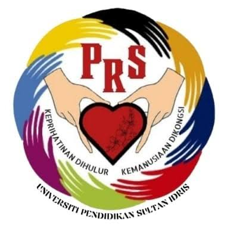

<div align="center">
  

  # PRS NEXUS

  **An integrated peer management and support system for Pembimbing Rakan Siswa.**

  A modern university portal for connecting members, coordinating committees,
  and keeping meetings and activities in one accessible place.

  [](https://laravel.com)
  [](https://www.php.net)
  [](https://tailwindcss.com)
  [](https://opensource.org/licenses/MIT)
</div>

---

## About the project

PRS NEXUS replaces scattered spreadsheets and manual records with a single platform for the PRS community at Universiti Pendidikan Sultan Idris (UPSI). Visitors can discover the organization through a public portal, members can manage their profiles and schedules, and administrators can maintain organizational records from a focused dashboard.

### What it provides

- A public landing page with community statistics and recent updates
- A searchable directory for members, committee roles, meetings, and activities
- A dedicated member portal with membership status, schedules, and profile management
- An administrative dashboard with summaries, recent records, and quick actions
- Full management of members, committee positions, meetings, and activities
- Session-based access control for member and administrator areas
- Responsive, accessible interfaces built around reusable Blade components

## User experiences

| Role | Capabilities |
| --- | --- |
| Public visitor | Explore PRS, browse the directory, and view community information |
| PRS member | Sign in, review upcoming meetings and activities, and update a personal profile |
| Administrator | Monitor the organization and manage members, committees, meetings, and activities |

## Built with

| Layer | Technology |
| --- | --- |
| Application | Laravel 12 · PHP 8.2+ |
| Interface | Blade · Tailwind CSS 4 · JavaScript |
| Assets | Vite 7 |
| Data | SQLite by default; Laravel-supported databases are configurable |
| Testing | PHPUnit 11 · Laravel HTTP tests |

## Getting started

### Prerequisites

Make sure the following are installed:

- PHP 8.2 or newer with the extensions required by Laravel
- Composer 2
- Node.js 20 or newer and npm
- SQLite, or another database supported by Laravel

### Installation

```bash
git clone 

composer install
npm install

cp .env.example .env
php artisan key:generate
```

Create the default SQLite database:

```bash
# macOS / Linux
touch database/database.sqlite

# Windows PowerShell
New-Item database/database.sqlite -ItemType File -ErrorAction SilentlyContinue
```

Prepare the application and sample data:

```bash
php artisan migrate --seed
php artisan storage:link
npm run build
```

Start the local development environment:

```bash
composer run dev
```

## Useful commands

```bash
# Run the automated test suite
composer test

# Format PHP source files
./vendor/bin/pint

# Build production frontend assets
npm run build

# Reset the database and reload sample records
php artisan migrate:fresh --seed
```

## Project structure

```text
app/
├── Http/Controllers/     # Public, member, and admin request handling
├── Http/Middleware/      # Portal access checks
├── Http/Requests/        # Form validation
└── Models/               # Application data models
database/
├── migrations/           # Database schema
├── factories/            # Test data factories
└── seeders/              # Local demonstration data
resources/
├── css/                  # Tailwind theme and shared UI styles
├── js/                   # Frontend entry point
└── views/                # Blade pages, layouts, and components
routes/web.php            # Public and authenticated web routes
tests/Feature/            # End-to-end application behavior tests
```


